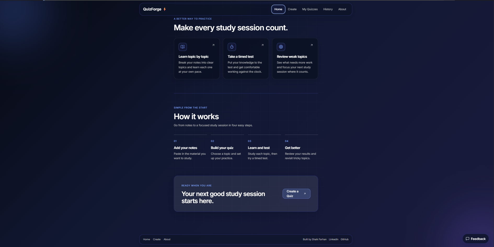
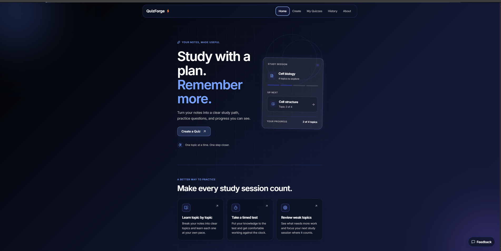
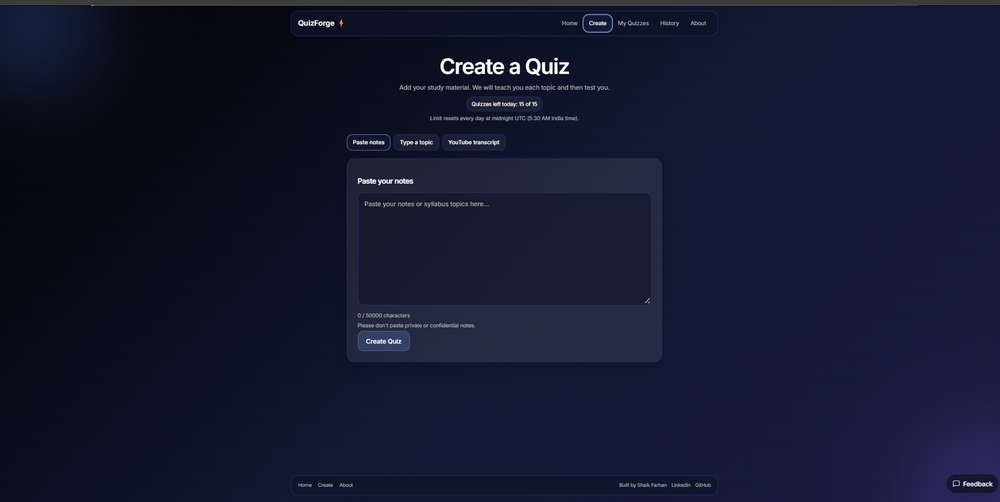
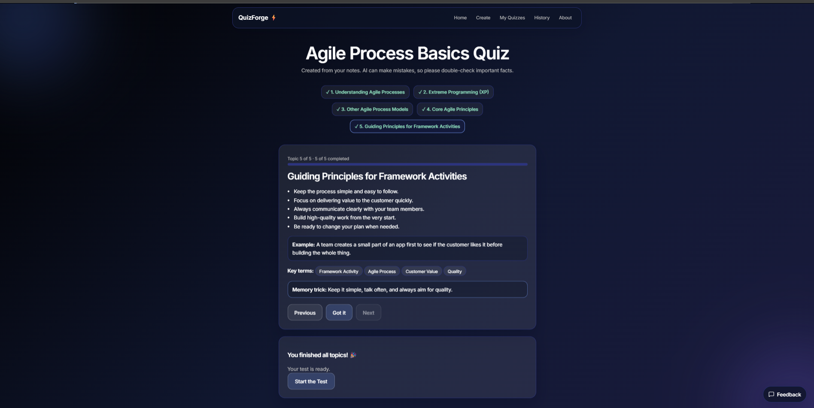
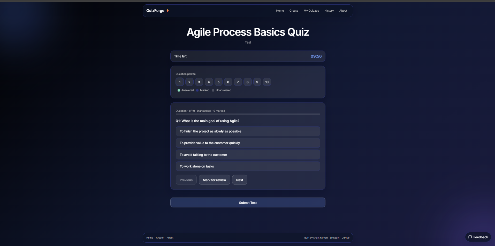
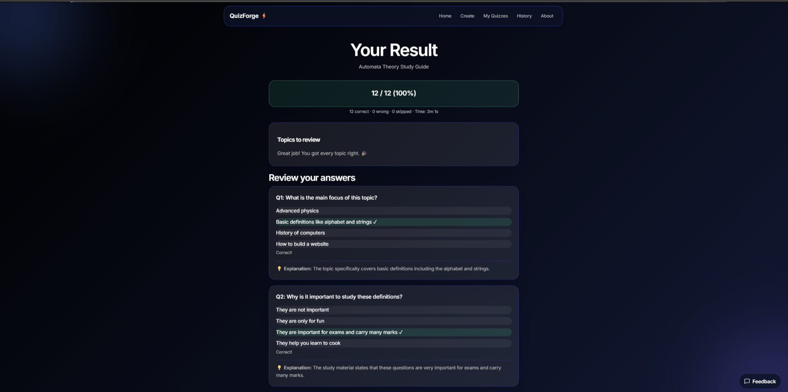

## Screenshots

| Home (top) | Home (more) |
|---|---|
|  |  |

| Create | Learn |
|---|---|
|  |  |

| Test | Result |
|---|---|
|  |  |

## Features

- Three ways to start: paste notes, type a topic, or paste a video transcript
- Learn mode: topic by topic with key points, an example, key terms and a memory trick
- The test unlocks only after all topics are completed
- Timed test with question palette, mark for review, auto-submit and submit confirmation
- Result page with score, answer review, explanations and weak topics
- History of past attempts (saved per device, no login needed)
- Labels such as "Created from your notes" or "Created from AI knowledge"

## Tech stack

- **Frontend:** React, Vite, React Router
- **Backend:** Node.js serverless functions on Vercel
- **Database:** MongoDB Atlas with Mongoose
- **AI:** Google Gemini API (free tier)

## What I focused on

- Caching: the same notes never trigger a second AI call
- Daily rate limit per device and input length limit
- Automatic retry when the AI service is busy
- Score is calculated on the server, so answers stay hidden during the test
- Page titles, meta descriptions, sitemap and noindex on private pages

## Run locally

1. Clone the repo and open the `client` folder.
2. Run `npm install`.
3. Create a `.env.local` file with these variable names:
   - `MONGODB_URI`
   - `GEMINI_API_KEY`
4. Run `npx vercel dev` and open http://localhost:3000

## Note

AI can make mistakes, so please double-check important facts. Please don't paste private or confidential notes.